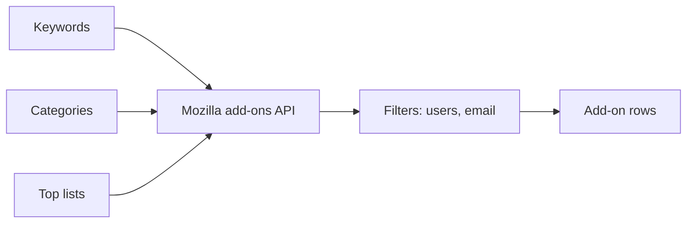

# Firefox Add-ons Scraper: Users, Ratings, Developers and Support Contacts

[](https://apify.com/Turboextract/firefox-addons)
[](LICENSE)
[](#pricing)

**Export Firefox add-ons by keyword, category or top lists, with average daily users, weekly downloads, rating, ratings and reviews count, categories, tags, version, created and updated dates, recommended badge, developer, homepage, support email and support link.** Research the browser extension market or build a list of extension developers. No API key.

In one test, the search "tab manager" returned 4,558 matches, and the top 5 came back in about 2 seconds, 4 of them with a support email.

**Try it now →** [apify.com/Turboextract/firefox-addons](https://apify.com/Turboextract/firefox-addons)

---

## Why this exists

- addons.mozilla.org shows add-ons a page at a time with no export.
- Users, ratings and developer contacts sit on separate pages.
- Extension intelligence tools charge $50+ a month.
- Partnership and research teams need the list in a spreadsheet.

---

## Who this is for

- **Extension developers** sizing a niche and tracking rivals
- **SaaS and B2B teams** finding extension makers to partner with or sell to
- **Investors and acquirers** looking for extensions with real users
- **Security and privacy researchers** listing add-ons by users and update age
- **Marketers** comparing their Firefox and Chrome footprint

---

## What you get

```json
{
  "id": 859942,
  "slug": "tab-session-manager",
  "name": "Tab Session Manager",
  "url": "https://addons.mozilla.org/en-US/firefox/addon/tab-session-manager/",
  "dailyUsers": 169957,
  "weeklyDownloads": 1679,
  "rating": 4.16,
  "ratingsCount": 1248,
  "reviewsCount": 577,
  "categories": ["appearance", "tabs"],
  "version": "7.4.0",
  "created": "2017-10-02T16:16:55Z",
  "lastUpdated": "2026-07-17T16:56:00Z",
  "recommended": true,
  "developers": ["sienori"],
  "homepage": "https://tab-session-manager.sienori.com/",
  "supportEmail": "s*****@sienori.com",
  "supportUrl": null
}
```

---

## How it works



---

## Quick start

1. Click **Try for free**.
2. Add **Search keywords**, like `password manager`, or **Categories** like `privacy-security`.
3. Optional: pick **Sort**, like Most users or Trending.
4. Optional: set **Minimum daily users** or **Only with support email**.
5. Click **Start**, then export to CSV, JSON, Excel or Google Sheets.

### API

```bash
curl -X POST "https://api.apify.com/v2/acts/Turboextract~firefox-addons/run-sync-get-dataset-items?token=YOUR_TOKEN" \
  -H "Content-Type: application/json" \
  -d '{"categories": ["shopping"], "sort": "users", "minUsers": 1000, "maxResults": 300}'
```

### Python

```python
from apify_client import ApifyClient

client = ApifyClient("YOUR_TOKEN")
run = client.actor("Turboextract/firefox-addons").call(run_input={
    "searchQueries": ["ai assistant"],
    "onlyWithEmail": True,
})
for a in client.dataset(run["defaultDatasetId"]).iterate_items():
    print(a["name"], a["dailyUsers"], a["homepage"])
```

---

## Input fields

| Field | Default | What it does |
|---|---|---|
| `searchQueries` | – | Add-on search keywords |
| `categories` | – | Category slugs, like productivity |
| `addonType` | extension | Extensions or themes |
| `sort` | relevance | Relevance, users, rating, trending, newest, updated, downloads |
| `minUsers` | 0 | Daily users floor |
| `onlyWithEmail` | false | Only add-ons with a support email |
| `maxResults` | 50 | Total cap per run |

---

## Pricing

**$0.001 per add-on delivered.** 1,000 add-ons cost $1.

| Option | 1,000 add-ons |
|---|---|
| **Firefox Add-ons Scraper** | **$1**, contacts included |
| Extension intelligence tools | $50+ a month |

---

## Common use cases

- **Niche sizing**: total users across every add-on for a keyword
- **Partner lists**: extension makers in your category with a support email
- **Competitor tracking**: rating and users for rival extensions over time
- **Acquisition leads**: add-ons with many users and no update in a year
- **Cross-browser research**: compare with Chrome Web Store data

---

## Tips for best results

- Category slugs include `privacy-security`, `productivity`, `shopping`, `tabs`, `social-communication` and `download-management`.
- `dailyUsers` is Mozilla's average over recent days.
- The support email is what the developer chose to publish on the add-on page.
- Use Trending sort to find fast-growing add-ons.

---

## Pairs well with

- [Chrome Extension Leads](https://apify.com/Turboextract/chrome-extension-leads): the same data for Chrome
- [WordPress Plugins Scraper](https://apify.com/Turboextract/wordpress-plugins): WordPress plugin developers
- [npm Packages Scraper](https://apify.com/Turboextract/npm-packages): JavaScript library adoption

---

## FAQ

**Do I need a Firefox account?** No. The actor uses Mozilla's public add-ons API.

**Why is the support email empty?** Many developers don't publish one.

**Does it include Android add-ons?** Yes. `androidSupport` shows which ones work on Firefox for Android.

**How fresh is the data?** It is read live on every run.

**Is it legal?** It uses Mozilla's official public API. Follow anti-spam rules when you email.

---

## SEO keywords

Firefox add-ons scraper, Firefox extensions data, addons.mozilla.org API export, browser extension leads, Firefox extension developers list, extension market research, Firefox add-ons to CSV, browser extension users data, extension developer email, Chrome and Firefox extension data

---

## Support

- Actor page: https://apify.com/Turboextract/firefox-addons
- Issues and questions: open an issue in this repo
- Community Discord: https://discord.gg/8SrXSCpvgj

Built and maintained by [Turboextract](https://apify.com/Turboextract) on the Apify platform.

---

## License

The documentation and examples in this repository are MIT licensed. The actor itself runs on the Apify platform.
